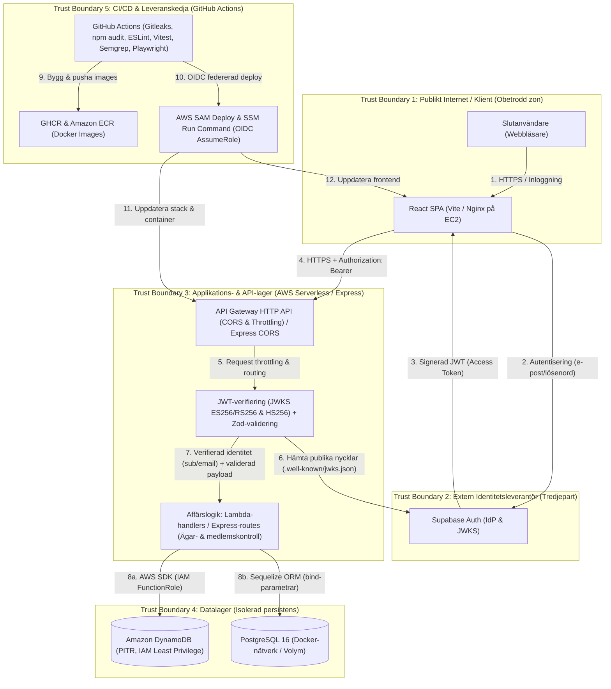

# Säkerhetsanalys och Hotmodellering – DevSecOps Quiz-plattform

Detta dokument utgör projektets samlade säkerhetsanalys, hotmodellering (STRIDE / OWASP), verifieringsplan, incidenthanteringsplan och statusredovisning för kursens sju delar. För mallen och genomförandet av incidentövningen kring läckt testtoken, se även [`INCIDENT_RESPONSE.md`](./INCIDENT_RESPONSE.md).

---

## 1. Omfattning, systemavgränsning och dataflödesdiagram (DFD)

### 1.1 Syfte och omfattning
Projektet är en quiz- och grupptjänst med konton, profiler, gruppmedlemskap, quiz och resultat. Frontend använder **Supabase Auth**. Repot innehåller **två backendalternativ** som delar samma React-frontend:
1. **Moln-/Serverless-arkitektur (Primär produktionsmiljö i AWS)**: React-frontend (byggd via [`frontend/quiz/Dockerfile.prod`](./frontend/quiz/Dockerfile.prod) med Nginx och driftsatt på **AWS EC2** via **Amazon ECR** och **AWS Systems Manager / SSM**), **Amazon API Gateway (HTTP API)**, **AWS Lambda** (Node.js 22, en funktion per endpoint) och **Amazon DynamoDB** (med *Point-in-Time Recovery* och `UniqueKeys`-låstabell), definierat som *Infrastructure as Code* i [`serverless/template.yaml`](./serverless/template.yaml).
2. **Containeriserad Express-arkitektur (Lokal referens- och utvecklingsmiljö)**: React-frontend, **Express.js REST API** och **PostgreSQL 16** med Sequelize ORM, orkestrerat med **Docker Compose** i [`docker-compose.yaml`](./docker-compose.yaml).

**Utanför projektets direkta kontroll (Shared Responsibility Model):**
- Underliggande drift av **Supabase Auth** (identitetsleverantör och JWKS-endpoint) samt **AWS-infrastruktur** (fysisk säkerhet, hypervisor, hanterade tjänster). Projektgruppen ansvarar för IAM-roller, CORS, JWT-validering, objektsauktorisation (BOLA), loggsanering, tabellkonfiguration och CI/CD-hemligheter.

### 1.2 Dataflödesdiagram (DFD) och förtroendegränser (Trust Boundaries)



### 1.3 Sammanfattning av förtroendegränser
- **TB1 → TB2 (Klient till Supabase Auth):** Användaruppgifter skickas direkt över HTTPS till Supabase. Lösenord passerar inte projektets primära inloggningsflöde i frontend.
- **TB1 → TB3 (Klient till API):** Alla skyddade API-anrop korsar gränsen från en obetrodd webbläsare till API Gateway / Express. Varje anrop måste autentiseras via `Authorization: Bearer <token>` och kontrolleras mot objektägarskap/gruppmedlemskap.
- **TB3 → TB4 (API till Databas):** Lambda-funktioner använder en dedikerad IAM-roll (`FunctionRole`) begränsad till specifika DynamoDB-tabeller och index. Express-backenden kommunicerar med PostgreSQL via Sequelize ORM med parametriserade frågor.
- **TB5 → TB3/TB4 (CI/CD till Molnmiljö):** GitHub Actions autentiserar mot AWS via OIDC (`aws-actions/configure-aws-credentials` med `role-to-assume`) och publicerar endast efter att säkerhetskontroller (Gitleaks, SCA, Lint, enhetstester, Semgrep SAST och Playwright BDD) passerat.

---

## 2. Tillgångar och skyddsvärde

| Tillgång | Exempel / plats | Konfidentialitet | Integritet | Tillgänglighet |
|---|---|---|---|---|
| **Identiteter och profiluppgifter** | E-post, användarnamn, för-/efternamn, `auth_id` och `user_id` i `Users` (DynamoDB) / `users` (PostgreSQL) | Hög | Hög | Medel |
| **Autentiseringsuppgifter och sessioner** | Lösenord hos Supabase Auth (och ev. bcrypt-hash vid lokal/legacy auth); signerad JWT i klientens session | Hög | Mycket hög | Hög |
| **Signerings-, API- och molnhemligheter** | `SUPABASE_JWT_SECRET`, `JWT_SECRET`, `AWS_ROLE_ARN`, databaskonton | Mycket hög | Mycket hög | Hög |
| **Grupper och inbjudningskoder** | Gruppnamn, `owner_id`, medlemslista (`GroupMembers`), 6-teckens `invite_code` och `UniqueKeys` | Medel | Hög | Medel |
| **Quizinnehåll och facit** | Frågor, svarsalternativ och `correctAnswer` i `Quizzes` / `quizzes` | Medel | Hög | Medel |
| **Quizresultat och topplistor** | Poäng, procent, antal försök (`attempt_count`), `user_id`, `quiz_id` och tidsstämpel i `QuizResults` | Hög | Hög | Medel |
| **Databas och driftkonfiguration** | DynamoDB-tabeller (med PITR), PostgreSQL-volym, `template.yaml`, Dockerfiles, EC2/Nginx-konfiguration | Hög | Mycket hög | Hög |
| **Källkod och CI/CD-leveranskedja** | GitHub-repo, `.github/workflows/ci-cd.yaml`, npm-beroenden, GHCR- och ECR-images | Medel | Mycket hög | Hög |

---

## 3. Attackytor, viktiga risker och riskprioritering (STRIDE & OWASP)

Skala: **Sannolikhet (S)** och **Konsekvens (K)** anges på skalan 1–5. **Riskvärde = S × K**: 1–4 Låg, 5–9 Medel, 10–15 Hög, 16–25 Kritisk. Tabellen redovisar både **ursprunglig risk**, **nuläge i repot** och **prioriterad åtgärd**.

| ID / hot (STRIDE, OWASP) | Attackväg och möjlig konsekvens | Ursprunglig risk (S × K) | Nuläge i repot | Prioriterad åtgärd & kvarvarande risk |
|---|---|---:|---|---|
| **T1 – BOLA/IDOR och obehörig åtkomst till användaruppgifter** (`E`, `I` – OWASP API1/API5, A01) | Manipulera UUID i `/api/user/:user_id`, `/api/groups/:groupId`, `/api/quizzes/:id` eller `/api/quizzes/:id/results`. Även om `GET /api/users` och `GET /api/user/:user_id` nu kräver JWT och exkluderar `password`, returnerar listan många användare och profilrutten kontrollerar inte att profilen tillhör den inloggade användaren. | 4 × 5 = **20 (Kritisk)** | `GET /api/users`, `GET /api/user/:user_id` och `POST /api/sync-user` kräver giltig JWT (`checkJwt` / `authenticate`) och exkluderar `password`. Grupp-, quiz- och resultat-endpoints (`?view=mine` och `?view=leaderboard`) kontrollerar gruppmedlemskap/ägarskap. Verifierat i [`profileSecurity.test.js`](./backend/tests/auth/profileSecurity.test.js) och [`quizResults.test.js`](./backend/tests/quizzes/quizResults.test.js). | **Hög/Medel (2 × 4 = 8):** Begränsa vilka profiler och fält som kan läsas i `GET /api/users` och `GET /api/user/:user_id`, samt dölj `correctAnswer` i `GET /api/quizzes/:id` tills quizet rättas. |
| **T2 – Tokenförfalskning, kapning eller test-bypass** (`S` – OWASP A07, API2) | Stulen JWT eller utnyttjande av fallback-verifiering ger angriparen användarens behörighet. Session i webbläsaren kan läsas vid XSS eller om token loggas i konsolen. | 3 × 5 = **15 (Hög)** | Test-bypassen för tokens med `"test"` är borttagen i både [`backend/middleware/supabaseAuth.js`](./backend/middleware/supabaseAuth.js) och [`serverless/src/lib/auth.js`](./serverless/src/lib/auth.js). Båda verifierar asymmetriska Supabase-tokens mot JWKS (`ES256`/`RS256`) och har kontrollerad HMAC-fallback. | **Medel/Hög (2 × 4 = 8):** Säkerställ att produktionsmiljön begränsar algoritm, issuer och audience som avsett och att legacy-/testhemligheter inte ger oavsedd väg in. Flytta Lambda-hemligheter till SSM/Secrets Manager vid skarp drift. |
| **T3 – Exponering av sessionstoken och personuppgifter i klient-/applikationsloggar** (`I`, `S` – OWASP A09, A07) | [`frontend/quiz/src/App.tsx`](./frontend/quiz/src/App.tsx) loggar `SUPABASE AUTH TOKEN` till webbläsarkonsolen. [`backend/Api/Quizzes/createQuiz.js`](./backend/Api/Quizzes/createQuiz.js) loggar användar-ID, e-post och quizdata, och vissa felhanterare loggar databasfel. | 4 × 4 = **16 (Kritisk)** | Identifierat vid kodgranskning och valt som scenario för gruppens praktiska incidentövning i [`INCIDENT_RESPONSE.md`](./INCIDENT_RESPONSE.md). | **Kritisk/Hög tills rensad:** Ta bort tokenloggningen i `App.tsx` och debugloggar med e-post/PII i `createQuiz.js` under incidentövningen; återkalla berörda testsessioner i Supabase. |
| **T4 – Skadligt användarinnehåll / Stored XSS** (`T`, `E` – OWASP A03, API8) | Skadligt gruppnamn, quiztitel, fråga eller svarsalternativ sparas i databasen och exekveras i andra gruppmedlemmars webbläsare. | 3 × 4 = **12 (Hög)** | Zod-scheman i [`ValidationForSchemas.js`](./backend/validations/ValidationForSchemas.js) och serverless-validering begränsar typer, format och stränglängder. React escape:ar textinnehåll automatiskt vid rendering och `dangerouslySetInnerHTML` används inte. | **Medel (2 × 4 = 8):** Komplettera `nginx.conf` i `Dockerfile.prod` med strikt `Content-Security-Policy` (CSP), `X-Content-Type-Options: nosniff` och `X-Frame-Options: DENY`. |
| **T5 – API brute force, gissning av inbjudningskod & DoS** (`D` – OWASP A04/A05, API4) | Automatiserade anrop mot inloggning, registrering eller `/api/groups/join` för att gissa 6-teckens inbjudningskoder eller överbelasta API/databas. | 3 × 4 = **12 (Hög)** | **Löst i AWS Serverless:** I [`serverless/template.yaml`](./serverless/template.yaml) har API Gateway `ThrottlingBurstLimit: 50`, `ThrottlingRateLimit: 25` och strikt CORS (`AllowOrigins: [!Ref AllowedOrigin]`). Express har global CORS och saknar egen rate-limit-middleware. | **Medel (2 × 3 = 6)** i AWS; **Hög (12)** i fristående Express. Begränsa CORS för Express och inför `express-rate-limit` där auth eller inbjudningskoder kan missbrukas. |
| **T6 – SQL-/NoSQL-injektion och datakorruption** (`T` – OWASP A03) | Manipulerad indata förändrar databasfrågor i PostgreSQL eller nyckelstrukturer i DynamoDB, eller skapar dubbletter vid samtidiga anrop (*race conditions*). | 2 × 5 = **10 (Hög)** | **Åtgärdat:** Express använder Sequelize modellmetoder (parametriserade frågor) och UUID-validering (`zod` / `uuid`). Serverless använder DynamoDB `DocumentClient` med typade nycklar och transaktionella låsposter i `UniqueKeysTable` (`email#`, `username#`, `auth#`, `invite#`). | **Medel (1 × 5 = 5):** Bibehåll Semgrep SAST i CI för att fånga eventuell framtida rå SQL eller osäker serialisering. |
| **T7 – Sårbara beroenden, byggkedja och osäker driftskonfiguration** (`S`, `T`, `E` – OWASP A05, A06) | Sårbara npm-paket, läckta hemligheter i git, `root`-containrar, avstängd TLS-validering eller lokal dev-Compose i produktion. | 3 × 5 = **15 (Hög)** | **Åtgärdat:** `.env` är untracked och Gitleaks skannar historiken. `minimatch` och `uuid` är åtgärdade via `overrides` i samtliga tre paket (`0 vulnerabilities`). `USER node` är infört i `backend/Dockerfile` och `frontend/quiz/Dockerfile`, och PostgreSQL SSL verifierar certifikat som standard (`DB_SSL_REJECT_UNAUTHORIZED !== "false"`). | **Medel (2 × 4 = 8):** Använd Compose endast för lokal utveckling med testdata. Överväg container image scanning (Trivy) och SHA-pinnade GitHub Actions. |

**STRIDE-förklaring:** `S` = Spoofing (Identitetsförfalskning), `T` = Tampering (Manipulering), `R` = Repudiation (Förnekande), `I` = Information Disclosure (Informationsläckage), `D` = Denial of Service (Tillgänglighetsattack), `E` = Elevation of Privilege (Rättighetseskalering).

---

## 4. Prioriterad åtgärdsplan (Shift Left) och genomförandestatus

| Prioritet | Åtgärd | Status | Bevis i repot |
|---|---|---|---|
| **P0 – Kritisk** | Kräv autentisering på `/api/users`, `/api/user/:user_id` och `/api/sync-user`; exkludera `password` och verifiera ägarskap vid uppdatering/radering. | ✅ **Genomfört** | [`backend/Api/UserRoute/getUsers.js`](./backend/Api/UserRoute/getUsers.js), [`getUserById.js`](./backend/Api/UserRoute/getUserById.js), [`syncUser.js`](./backend/Api/UserRoute/syncUser.js), [`serverless/src/handlers/`](./serverless/src/handlers) samt [`profileSecurity.test.js`](./backend/tests/auth/profileSecurity.test.js). |
| **P0 – Kritisk** | Ta bort osäker `"test"`-token-bypass i JWT-verifiering och kräv giltig signatur (JWKS eller kryptografisk hemlighet). | ✅ **Genomfört** | [`backend/middleware/supabaseAuth.js`](./backend/middleware/supabaseAuth.js), [`serverless/src/lib/auth.js`](./serverless/src/lib/auth.js) och [`serverless/tests/auth-http.test.js`](./serverless/tests/auth-http.test.js). |
| **P0 – Kritisk** | Säkerställ gruppmedlems-/ägarkontroll på alla grupp-, quiz- och resultat-endpoints (`mine` & `leaderboard`). | ✅ **Genomfört** | [`backend/Api/Quizzes/getQuizResults.js`](./backend/Api/Quizzes/getQuizResults.js), [`serverless/src/handlers/getQuizResults.js`](./serverless/src/handlers/getQuizResults.js) samt [`quizResults.test.js`](./backend/tests/quizzes/quizResults.test.js). |
| **P0 – Incident & Logg** | Genomför incidentövning kring läckt testtoken i `App.tsx`, återkalla testsession och rensa token-/PII-loggning i klient och backend (`createQuiz.js`). | 🔄 **Planerad övning** | Mall och steg i [`INCIDENT_RESPONSE.md`](./INCIDENT_RESPONSE.md). |
| **P1 – CI/CD & SAST/SCA** | Aktivera ESLint, `npm audit --audit-level=high`, enhetstester, Playwright BDD, Gitleaks och Semgrep SAST för frontend, backend och serverless i CI, samt åtgärda Semgrep/SCA-fynd. | ✅ **Genomfört** | [`.github/workflows/ci-cd.yaml`](./.github/workflows/ci-cd.yaml), [`backend/Dockerfile`](./backend/Dockerfile), [`frontend/quiz/Dockerfile`](./frontend/quiz/Dockerfile), [`backend/config/database.js`](./backend/config/database.js) och [`serverless/package.json`](./serverless/package.json). |
| **P1 – Moln & Drift** | Produktionsanpassad frontend-container (`Dockerfile.prod` med Nginx), API Gateway throttling/CORS, IAM least-privilege och DynamoDB Point-in-Time Recovery. | ✅ **Genomfört** | [`frontend/quiz/Dockerfile.prod`](./frontend/quiz/Dockerfile.prod), [`serverless/template.yaml`](./serverless/template.yaml) och AWS-deployjobben i `ci-cd.yaml`. |

---

## 5. Verifieringsplan och nulägesstatus

Verifiering utförs automatiskt vid varje push och pull request i GitHub Actions samt lokalt mot isolerade testmiljöer (Vitest med mockad/in-memory-databas respektive DynamoDB Local i Docker).

| Kontroll | Hur verifieras | Nuläge i repot / Resultat |
|---|---|---|
| **Enhetstester & API-auktorisation** | `npm test` i `backend/` (11 testsviter), `serverless/` och `frontend/quiz/`. Prövar `401` (saknad/ogiltig token), `403` (icke-medlem/fel ägare), `400` (ogiltig UUID/Zod) och `200`/`201`. | **Aktivt i CI och verifierat.** Omfattar bl.a. `profileSecurity.test.js`, `quizResults.test.js`, `groups.test.js`, `quizzesCrud.test.js` samt serverless handler-/auth-/repo-tester. |
| **Statisk kodanalys (SAST) & Linting** | Semgrep (`semgrep/semgrep-action@v1`) och ESLint (`npm run lint`) i `frontend/quiz`, `backend` och `serverless`. | **Aktivt i CI och verifierat lokalt (`0 Code Findings` i app & Dockerfiles).** |
| **Beroendekontroll (SCA) & Hemligheter** | `npm audit --audit-level=high` i samtliga tre paket samt Gitleaks (`gitleaks/gitleaks-action@v2` med `.gitleaks.toml`). | **Aktivt i CI och verifierat (`0 vulnerabilities` i `frontend/quiz`, `backend` och `serverless`).** |
| **BDD / E2E-tester** | Gherkin-scenarier i `frontend/quiz/e2e/features/` körs med Playwright (`npx bddgen && npx playwright test`). | **Aktivt i CI (`ci-cd.yaml` steg 4).** |
| **Container & Infrastruktur (IaC)** | `docker compose up --build` för lokal stack; `Dockerfile.prod` + `serverless/template.yaml` för produktionsstack i AWS. | **Genomfört.** Separerar lokal utvecklings-Compose från produktions-Dockerfile (`Dockerfile.prod`) och AWS SAM-mall. |
| **Molndeployment (CD)** | Automatisk deploy vid push till `main` (efter grön CI): `sam deploy` till `quiz-serverless` och containerdeploy till ECR + EC2 via SSM med hälsokontroll (`.github/scripts/deploy-frontend.sh`). | **Aktivt i `.github/workflows/ci-cd.yaml`** (`deploy-backend-aws` och `deploy-frontend-aws`). |

### 5.1 Genomförd SAST-, SCA- och AI-säkerhetsgranskning samt åtgärdade fynd

Vid exekvering av **Semgrep CLI (`semgrep scan --config auto`)**, **npm audit (SCA)** och **AI-assisterad kodgranskning** mot hela kodbasen identifierades och åtgärdades följande fynd:

1. **Applikationskod i `serverless/`, `backend/` och `frontend/quiz/src/` (0 SAST-fynd efter åtgärd):**
   - Inga sårbarheter för SQL/NoSQL-injektion, kommandoinjektion, XSS (`dangerouslySetInnerHTML`) eller osäker autentisering hittades i vare sig AWS Lambda-handlers (`serverless/src/`), Express-routes (`backend/Api/`) eller React-applikationen (`frontend/quiz/src/`).
   - *Manuellt/AI-granskat fynd inför incidentövning:* Identifierade debugloggning av sessionstoken i `frontend/quiz/src/App.tsx` och användar-e-post i `backend/Api/Quizzes/createQuiz.js`, vilket dokumenterats i `T3` och [`INCIDENT_RESPONSE.md`](./INCIDENT_RESPONSE.md).
2. **Upptäckta och åtgärdade Semgrep SAST-fynd (`0 Code Findings` efter fix):**
   - **`dockerfile.security.missing-user` (`backend/Dockerfile`, `frontend/quiz/Dockerfile`) – ✅ Åtgärdat:** Semgrep flaggade att utvecklings-Dockerfiles saknade `USER`-direktiv och därmed körde som `root`. Vi lade till `COPY --chown=node:node . .` och `USER node` i båda Dockerfiles så att containrarna kör som icke-privilegierad användare.
   - **`bypass-tls-verification` (`backend/config/database.js`, `backend/database/database.js`) – ✅ Åtgärdat:** Semgrep flaggade hårdkodat `rejectUnauthorized: false` i PostgreSQL SSL-konfigurationen (risk för Man-in-the-Middle-attacker om CA-certifikat inte valideras). Vi ändrade detta till att som standard kräva certifikatverifiering (`process.env.DB_SSL_REJECT_UNAUTHORIZED !== "false"`). Vid förnyad körning av Semgrep mot `backend`, `serverless` och `frontend` rapporteras **0 SAST-fynd**.
3. **Beroendeskanning med `npm audit` (SCA – `0 vulnerabilities` i samtliga paket):**
   - `frontend/quiz`: **0 sårbarheter** (`minimatch` uppdaterad till `^11.0.1` via `overrides` i Issue #55 / PR #58).
   - `backend`: **0 sårbarheter** (`minimatch` `^11.0.1` och `uuid` `^11.1.1` via `overrides`).
   - `serverless`: **0 sårbarheter** (efter att vi även lagt till `"overrides": { "minimatch": "^11.0.1" }` i [`serverless/package.json`](./serverless/package.json) och uppdaterat [`serverless/package-lock.json`](./serverless/package-lock.json)).
4. **Kvarvarande observation i CI-workflow (`github-actions-mutable-action-tag`):**
   - I [`.github/workflows/ci-cd.yaml`](./.github/workflows/ci-cd.yaml) refereras GitHub Actions med versions-taggar (t.ex. `actions/checkout@v4`) istället för 40-teckens commit-SHA. *Triagering:* Dokumenterat under `T7` (Supply-chain); acceptabelt inom kursprojektet men rekommenderas att SHA-pinnas i skarp produktionsmiljö.

### Verifierade BDD- och säkerhetsscenarier (Gherkin)

```gherkin
Feature: Åtkomstkontroll och objektsbehörighet (BOLA)
  Scenario: Oautentiserad klient eller test-token nekas åtkomst till användardata
    When klienten anropar GET /api/users utan token eller med "Bearer invalid-test-token"
    Then svarar API:t med status 401
    And inga användaruppgifter eller lösenordshashar returneras

  Scenario: Användare kan endast uppdatera eller radera sin egen profil
    Given användare A är inloggad med giltig Supabase-JWT
    When användare A anropar PUT /api/update-user/<användare_B_uuid>
    Then svarar API:t med status 403
    And användare B:s profil förblir oförändrad

  Scenario: Icke-medlem nekas åtkomst till gruppspecifika quiz och resultat
    Given användare A är medlem i grupp A men inte i grupp B
    When användare A anropar GET /api/quizzes/<grupp_B_quiz_id>/results?view=leaderboard
    Then svarar API:t med status 403
    And inga resultat eller deltagarnamn returneras
```

---

## 6. Loggning, övervakning och incidenthantering (Del 6 & 7)

### 6.1 Loggning och övervakning
- **AWS CloudWatch Logs & Metrics (Serverless-produktion):** Alla Lambda-funktioner loggar exekvering, fel och ohanterade undantag till **Amazon CloudWatch Logs** via `AWSLambdaBasicExecutionRole`. API Gateway och Lambda exponerar inbyggda mätvärden för `Count`, `4XXError`, `5XXError`, `Latency` och `ThrottledRequests` (begränsade via `ThrottlingRateLimit: 25` och `ThrottlingBurstLimit: 50`).
- **Lokal miljö:** I Docker Compose granskas applikations- och databasloggar via `docker compose logs -f backend` och container-healthchecks (`pg_isready` för PostgreSQL).
- **Kvar att verifiera & rensa:** Säkerställa att debugloggar för access token (`App.tsx`) och e-post/PII (`createQuiz.js`) tas bort och verifiera i driftloggarna att inga känsliga uppgifter skrivs ut.

### 6.2 Incidenthantering och incidentövning (`INCIDENT_RESPONSE.md`)
Gruppens fullständiga övningsupplägg för incidenthantering finns i [`INCIDENT_RESPONSE.md`](./INCIDENT_RESPONSE.md) (**Incidentövning: läckt testtoken**):
1. **Upptäckt och rapportering:** Upptäckt av att en inloggad testanvändares access token skrivits ut i webbläsarkonsolen (`App.tsx`). Dokumentera tidpunkt, testkonto och miljö utan att kopiera själva token.
2. **Begränsning:** Återkalla testkontots session i Supabase, verifiera att den gamla token nekas (`401`) och ta bort källan till tokenloggningen i koden.
3. **Undersökning och åtgärd:** Granska klient- och driftloggar (t.ex. CloudWatch / Docker-loggar) och källkod för att säkerställa att inga fler tokens eller onödiga personuppgifter loggas (t.ex. i `createQuiz.js`).
4. **Återställning och uppföljning:** Bekräfta att ny testinloggning fungerar utan att logga token, kör CI-kontroller och fyll i resultat- och åtgärdstabellerna i [`INCIDENT_RESPONSE.md`](./INCIDENT_RESPONSE.md).
- *Kompletterande skydd vid databasincident i AWS:* Samtliga sex DynamoDB-tabeller i [`serverless/template.yaml`](./serverless/template.yaml) har **Point-in-Time Recovery (`PointInTimeRecoveryEnabled: true`)** och `DeletionPolicy: Retain` för säker återställning.

---

## 7. Kvarstående risker och avgränsningar

Använd syntetiska testkonton och testdata. Kursdemonstrationen ersätter inte extern penetrationstestning, jour, fullständig backup-/återställningsplan eller skydd mot storskalig överbelastning.

| Risk / avgränsning | Beslut och hantering inom kursprojektet |
|---|---|
| **Klientlagrad JWT i webbläsaren** | Supabase SDK lagrar sessionen i webbläsaren. Efter att konsolloggningen i `App.tsx` tagits bort reduceras risken genom Reacts automatiska textescaping, men en fullständig övergång till `HttpOnly`-cookies + CSRF-tokens ligger utanför kursprojektets ramar. |
| **Profilåtkomst & facit (`correctAnswer`) i API-svar** | `GET /api/users` och `GET /api/user/:user_id` kräver JWT och exkluderar lösenord, men begränsar ännu inte profil-GET till enbart egen användare. För gruppmedlemmar returnerar `GET /api/quizzes/:id` quizets frågor inklusive svar. Risken dokumenteras och avgränsas för kursdemon. |
| **DAST och extern penetrationstestning** | Automatiserad SAST (Semgrep), SCA (`npm audit`), Gitleaks, enhetstester och Playwright BDD körs i CI. Fullständig DAST (OWASP ZAP) och extern pentestning avgränsas bort från den automatiska pipelinen. |
| **Lokal Docker Compose vs. AWS-produktion** | Docker Compose använder utvecklingskonfiguration och lokala standardvärden för att underlätta lokal testning och ska inte användas som produktionskonfiguration. |

---

## 8. Översikt över uppgiftens sju delar

Tabellen sammanfattar status för kursens sju delmoment och vad som finns i repot respektive kvarstår att slutföra:

| Del | Status | Belägg i repo | Kvar att verifiera / slutföra |
|---|---|---|---|
| **1. Säkerhetsanalys och hotmodellering** | ✅ **Genomfört** | Detta dokument ([`SECURITY_ANALYSIS.md`](./SECURITY_ANALYSIS.md)) och [`README.md`](./README.md). | Håll riskloggen uppdaterad efter genomförd incidentövning. |
| **2. Säkerhetsåtgärder och verifiering** | ✅ **Genomfört** | JWT-verifiering (JWKS/HMAC), BOLA-kontroller på grupper/quiz/resultat, Zod-validering, lösenordsexkludering, Semgrep- och SCA-fixar samt sviter i `backend/tests/` och `serverless/tests/`. | Rensa debugloggning av token/PII och överväg snävare fältbegränsning på `/api/users`. |
| **3. Containerisering och infrastruktur** | ✅ **Genomfört** | [`docker-compose.yaml`](./docker-compose.yaml), [`backend/Dockerfile`](./backend/Dockerfile) (`USER node`), [`frontend/quiz/Dockerfile`](./frontend/quiz/Dockerfile) (`USER node`), [`frontend/quiz/Dockerfile.prod`](./frontend/quiz/Dockerfile.prod) samt IaC i [`serverless/template.yaml`](./serverless/template.yaml). | Starta Compose vid redovisning och visa hur tjänster, konfiguration och beständig lagring fungerar. |
| **4. CI/CD med säkerhetskontroller** | ✅ **Genomfört** | [`.github/workflows/ci-cd.yaml`](./.github/workflows/ci-cd.yaml) och [`.gitleaks.toml`](./.gitleaks.toml). | Gitleaks, `npm audit`, ESLint, Vitest, Semgrep SAST och Playwright BDD körs automatiskt i CI. |
| **5. Deployment i molnmiljö** | ✅ **Genomfört** | Jobben `deploy-backend-aws` (AWS SAM → API Gateway, Lambda, DynamoDB) och `deploy-frontend-aws` (Amazon ECR + EC2 via SSM + `.github/scripts/deploy-frontend.sh`) i `ci-cd.yaml`. | Verifiera AWS-deploy via publik URL med testkonto vid demo. |
| **6. Loggning och övervakning** | 🔄 **Delvis genomfört** | `AWSLambdaBasicExecutionRole` (CloudWatch Logs), API Gateway throttling/metrics i `template.yaml` och PostgreSQL healthcheck i `docker-compose.yaml`. | Ta bort token- och PII-debugloggar (`App.tsx`, `createQuiz.js`) och visa var driftloggar granskas. |
| **7. Incidenthantering** | 🔄 **Förberett / Övning kvarstår** | Incidentplan och övningsmall i [`INCIDENT_RESPONSE.md`](./INCIDENT_RESPONSE.md) samt avsnitt 6.2 i detta dokument. | Genomför incidentövningen (läckt testtoken) och fyll i tabellerna i `INCIDENT_RESPONSE.md`. |

---

## 9. Loggbok för säkerhetskontroller och verifiering

| Datum | Commit | Kontroll / Åtgärd | Resultat och fynd | Åtgärd / Ansvarig |
|---|---|---|---|---|
| 2026-10-27 | `887fe3a` | Gitleaks secret scanning & `.env`-hantering | Upptäckte historisk exponering i äldre commit; `.env` untracked. | Lade till `.gitleaks.toml`, Gitleaks i CI och `.env.example`. |
| 2026-10-31 | `f61e6da` / `547181d` | Initial säkerhetsanalys & hotmodellering (PR #43) | Identifierade P0-risker: publika `GET /api/users`-rutter, `password`-fält i svar och `"test"`-token-bypass. | Dokumenterade STRIDE-tabell och åtgärdsplan i `SECURITY_ANALYSIS.md`. |
| 2026-11-05 | `c8bec1f` / `6445ed5` | Införande av AWS Serverless-backend, profilskydd och säkerhetstester (PR #49, #52) | Åtgärdade P0-fynd i både Express och Serverless (`checkJwt` på profilrutter, borttagen test-bypass, exkluderat lösenord). | Verifierat med `profileSecurity.test.js` och serverless-testsvit i CI. |
| 2026-11-06 | `3827b19` / `59590cb` | Linting, SCA och CI/CD-härdning (PR #51, #53) | ESLint, `npm audit --audit-level=high`, Vitest och Semgrep SAST passerar i CI för `frontend`, `backend` och `serverless`. | Uppdaterade `.github/workflows/ci-cd.yaml` och CORS-konfiguration. |
| 2026-11-08 | `905feff` | Resultat- & topplistefunktion med gruppbehörighetskontroll (PR #54) | Verifierade att endast gruppmedlemmar/ägare kan nå `?view=mine` och `?view=leaderboard` (`403` för icke-medlemmar). | Verifierat med `quizResults.test.js` i både `backend/` och `serverless/`. |
| 2026-11-08 | `b4b9fb1` / `ee4223b` | SCA (`npm audit`), Playwright BDD i CI & EC2-deploy-härdning (PR #58, #59, Issue #55) | `minimatch` uppdaterad via `overrides` (`0 vulnerabilities` i `frontend` och `backend`). Playwright BDD aktiverat i CI och EC2-deployskriptet testas automatiskt (`test-deploy-frontend.sh`). | Mergat till `main`. |
| 2026-11-08 | `8287481` | Incidentövningsmall & kvarvarande riskpunkter (PR #57) | Lade till `INCIDENT_RESPONSE.md` och lyfte fram kvarvarande verifieringspunkter (bl.a. tokenloggning i `App.tsx` och debugloggar i `createQuiz.js`). | Mergat till `main`. |
| 2026-11-08 | `1826828` | Semgrep SAST (`--config auto`), `npm audit` & AI-säkerhetsgranskning (PR #60) | Upptäckte och åtgärdade `missing-user` i `backend/Dockerfile` & `frontend/quiz/Dockerfile` (`USER node`), `bypass-tls-verification` i `backend/config/database.js` & `backend/database/database.js` samt `minimatch`-override i `serverless/package.json`. **Resultat efter fix: 0 SAST-fynd i app/Dockerfiles och 0 `npm audit`-sårbarheter i alla 3 paket.** | Åtgärdat och verifierat (se avsnitt 5.1). |
